# DSH Agent Enhancer

English | [简体中文](./README.md)

> One plugin to make DeepSeek Harness Desktop **easier to write, refine, roll back, and see usage & context**, and to keep moving toward mainstream agent UX.  
> Prompt history · one-click optimize · next-prompt predict · conversation & file restore · model bill · context details · Auto routing · per-provider balance — inside the official conversation and settings, no extra window.

[](https://www.npmjs.com/package/dsh-agent-enhancer)
[](https://www.npmjs.com/package/dsh-agent-enhancer)
[](https://awesome-dsh-plugin.com)
[](./LICENSE)

---

## Know it in 30 seconds

| Category | You want to… | Do this |
| --- | --- | --- |
| **Write** | Revisit / clarify / continue | `↑↓` or `Alt+R`; **Optimize** on the right; after a reply, `Tab` for the gray suggestion |
| **Restore** | Truncate & retry | Bubble / timeline **Restore to here** (optional tracked files); **Undo restore** via **+** / `/` |
| **Usage & cost** | See tokens spent and remaining credit | **Token usage** → **Model bill**; **Settings → Models** for per-account balance; helpers can use a cheaper model or Auto |
| **Context** | See how full the window is | Context meter → right-pane details; optional **Compress context** |
| **Routing** | Let the session pick a strength tier | Choose **Auto** in the model list; map Instant / Thinking / Pro in settings |
| **Master switches** | Turn a feature off | **Settings → Built-in plugins → Agent Enhance** |

Core features default on. UI language follows Desktop (`zh` / `en`).

---

## Feature map

Grouped by capability; screenshots share a row so new features extend the matching category instead of lengthening the table.

| Category | Includes | How to use | Notes |
| --- | --- | --- | --- |
| **Write** | History · Optimize · Predict | First/last-line `↑↓`; `Alt+R` (`Ctrl+R` where available); Optimize on the right (undo; selection-only when selected); gray suggestion after a reply, `Tab` to accept | Current loaded session only; `Enter` fills without sending; chip drafts ignore history keys; vague drafts gain detail, specific drafts stay lean; at most one prediction per turn |
| **Restore** | Bubble restore · Checkpoint timeline · Undo restore | **Projection truncate (cut-first):** **Restore to here** on a message or the right-pane checkpoint timeline → preview first (conversation-only or + tracked **text** files, including deleted paths) → on confirm, write the projection cut then restore files; chat and the model hide everything past the cut **without** appending a tip to the DSH log. Use **+** / `/` → **Undo restore**. Optional: composer “N turns / M steps” → **Session statistics** title row also opens the timeline | File tracking = write/edit intents + Cline-style before/after workspace scan around shells, UTF-8 text only (PNG/WebP binaries are skipped). Multi-turn restore merges tracked files from the target turn through the tip. Official session stats keep full-log counts. No processes / terminals / untracked / binaries / external services. Existing checkpoints and projection cuts stay if you turn the switch off |
| **Usage & cost** | Token usage · Model bill · Per-provider balance | Open the bill from the usage title (today / 7d / 30d / all); **Settings → Models** for DeepSeek account / API-key balances | Local input / output / cache-read totals, heatmap, feature share; “≈ ¥” from official rates (not an invoice); account uses Platform wallets, API key uses `/user/balance`; two decimal places |
| **Context** | Meter · Details · Compact | Open the meter into the right pane; drill into categories; one-click official `/compact` | System / tools / messages breakdown; numbers are heuristic estimates, not bill-precise |
| **Routing** | Auto · Tier maps · Optional classifier | Pick **Auto** in the model list; map Instant / Thinking / Pro; optional small-model classifier | Bilingual heuristic by default; classifier failures fall back; optimize / predict may also use Auto or a fixed model |

### Settings

**Settings → Built-in plugins → Agent Enhance**

| Category | Toggles / config | Default | Effect |
| --- | --- | --- | --- |
| **Write** | `historyEnabled` · `optimizeEnabled` · `predictEnabled` | All on | `↑↓` / `Alt+R`; optimize & undo (model pill); gray predict (model pill) |
| **Restore** | `rollbackEnabled` | On | Bubble / timeline **Restore to here**; **+** / `/` **Undo restore** |
| **Context** | `contextInspectEnabled` | On | Context meter → right-pane details |
| **Routing** | `autoClassifierEnabled`, etc. | Classifier off | Session / helpers may use Auto; tier maps; optional classifier |
| **Maintenance** | Plugin updates | — | Check/apply for npm installs; link installs show guidance only |

Model pills default to **Follow session**, or pick provider / model / reasoning effort, or **Auto**. Live balance stays on **Settings → Models** cards, not as a single global line on the bill.

### UI map

| Category | What you see | Preview |
| --- | --- | --- |
| **Write** | History search; optimize control and gray prediction | 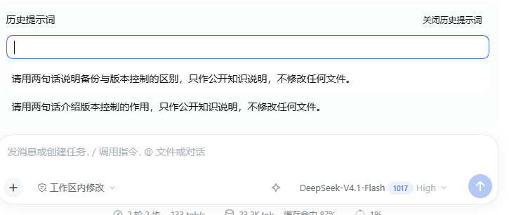 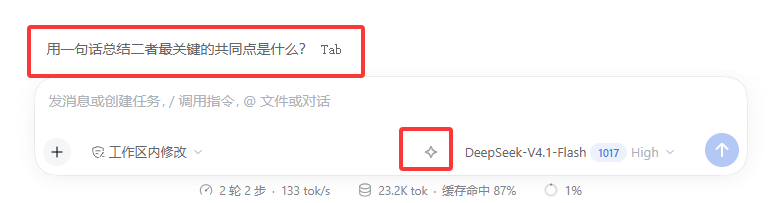 |
| **Restore** | Bubble / timeline restore → preview → undo; session-stats row optional |  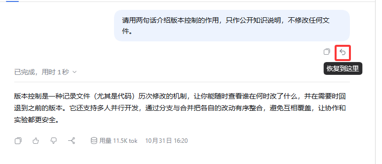 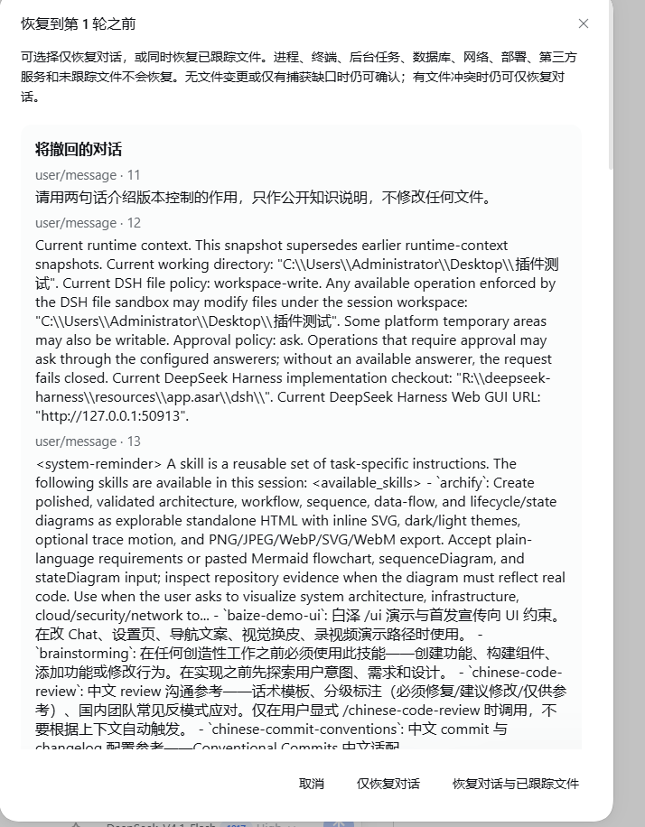 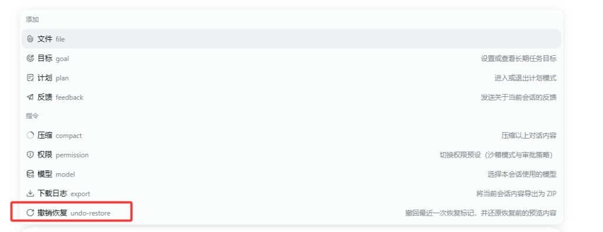 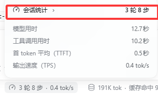 |
| **Usage & cost** | Token usage entry, model bill, per-provider balance | 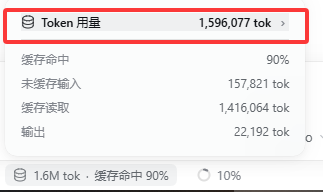 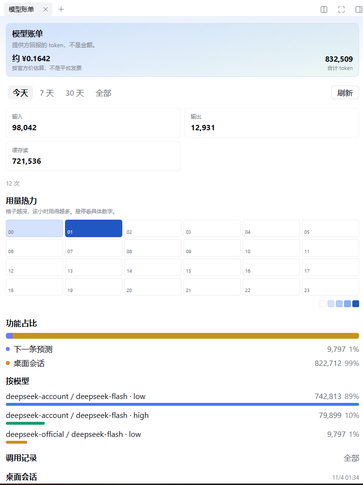 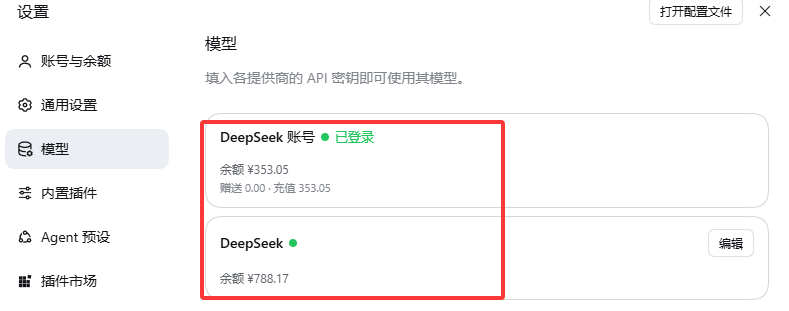 |
| **Context** | Meter summary and right-pane details / compact | 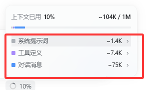 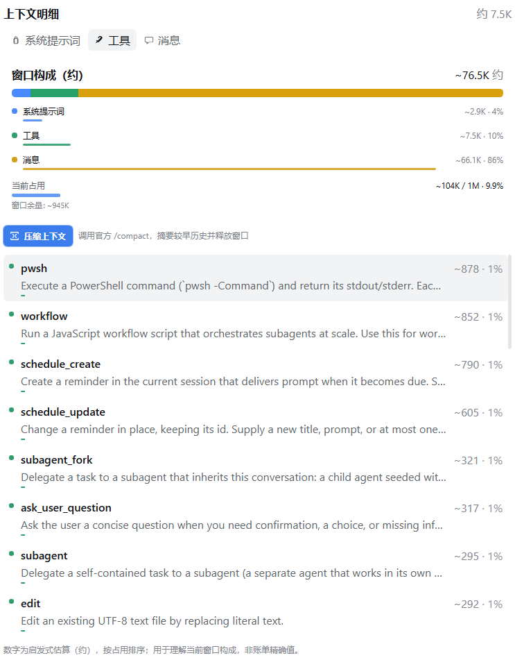 |
| **Routing** | Auto in the model list; tier maps and optional classifier | 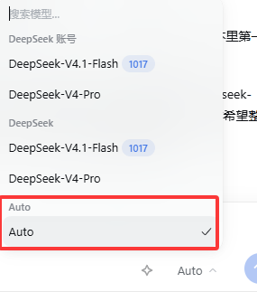 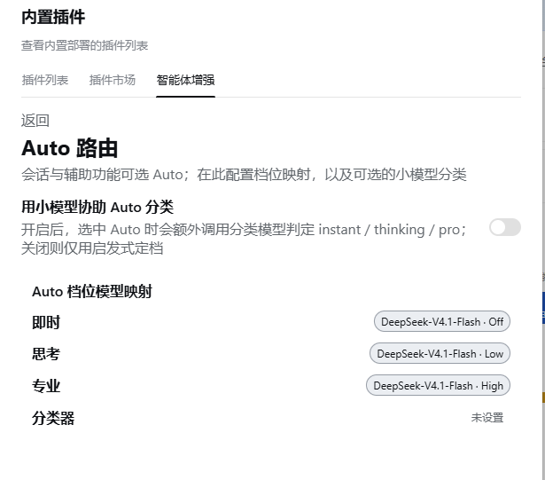 |
| **Settings** | Agent Enhance toggles and model pills | 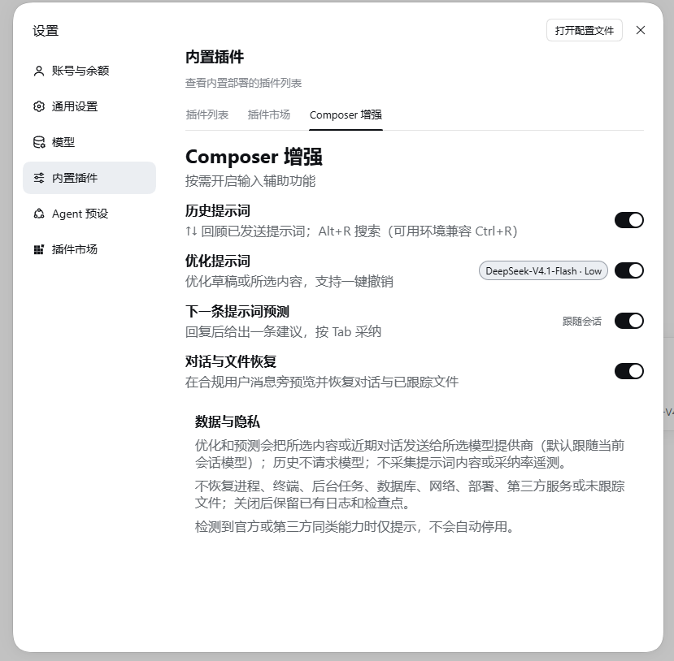 |

---

## Install

Quit every Desktop window and tray process before install, upgrade, or uninstall.  
This plugin targets **Desktop / the `desktop` profile** (do not validate with `web`). It is listed on [awesome-dsh-plugin](https://github.com/awesome-dsh-plugin/awesome-dsh-plugin); you can also search for `dsh-agent-enhancer` / **Agent Enhance** in third-party markets.

### Official Desktop · in-app install (recommended)

For the [DeepSeek Harness](https://github.com/deepseek-ai/deepseek-harness) **official Desktop** (and other official builds that ship **Settings → Plugins**):

1. Open **Settings → Plugins** (or the **Plugins** sidebar entry).
2. Search for `dsh-agent-enhancer` or **Agent Enhance**, then install when prompted.
3. Fully quit and restart Desktop.

> Desktop manages its own profile. Do **not** install into Desktop with `dsh plugin --profile web …` — the command may succeed while writing to `profiles/web`, which Desktop never loads.

### dsh-market (optional)

For a dedicated market UI / one-click upgrades, install the community market [dsh-market](https://github.com/dsh-market/dsh-market):

- **Official Desktop:** in-app **Settings → Plugins**, search `dshmarket` and install (do not use the CLI `web` profile).
- **Plain `dsh web`:** `dsh plugin --profile web add dshmarket`, then restart.

Then open the **Plugin Market** tab, search, and install this plugin. Some third-party Desktop clients ship or recommend this market by default.

### CLI · npm

When the `dsh` CLI is available and you intend to write the **desktop** profile:

```sh
dsh plugin --profile desktop add dsh-agent-enhancer@0.3.3
```

Or unpinned: `dsh plugin --profile desktop add dsh-agent-enhancer`.  
If you previously installed `dsh-composer-enhancer`, remove it first, then install this package.  
You should then see the optimize control and **Agent Enhance** in settings.

### Local directory (development)

**Do not** run `dsh plugin --profile desktop add <absolute-path>` against this repo: some Desktop / CLI builds rewrite the plugin `package.json` or corrupt the profile. Use the one-shot switchers (they only edit `~/.dsh/profiles/desktop/package.json`, **never** the plugin Git tree):

```powershell
corepack pnpm install --frozen-lockfile

# Local dev: build → pack → extract into profile/.dsh-enhancer-pack/pkg, then install
corepack pnpm desktop:link

# Back to npm (defaults to this package.json version; or: pnpm desktop:npm -- 0.3.3)
corepack pnpm desktop:npm
```

Fully quit and restart Desktop afterward. After local code changes, run `corepack pnpm desktop:link` again (pack-snapshot install; no live repo hot reload).  
Do not point `link:` / `file:` at the repo directory: on Windows that becomes a Junction and exposes this repo's `node_modules`, which leaves the plugin permanently off.  
Keep host-shared DSH packages in both `peerDependencies` and `devDependencies`, not in `dependencies`.

---

## Privacy & coexistence

| Topic | Detail |
| --- | --- |
| History | Never calls a model |
| Optimize | Sends draft/selection + latest completed turn |
| Predict | Sends the latest completed turn |
| Auto classifier | Only when the toggle is on; failures fall back to local heuristics without blocking the main request |
| Bill / context | Local aggregation and heuristic estimates; balance queries use Desktop-stored credentials — this plugin ships no keys |
| Cache | In-session memory (bill data persists under the local usage directory) |
| Audit | Local `plugin:agent-enhancer/request` (no telemetry upload) |
| Coexistence | Hints only — never auto-disables third-party plugins |

---

## Compatibility

- **DSH:** `>=0.2.2-rc.1 <0.3.0-0` (Desktop `0.2.2-rc.1`+)

---

## Uninstall

| Install type | Action |
| --- | --- |
| Official Desktop / dsh-market | Uninstall or disable the plugin on the in-app **Plugins** page; or `dsh plugin --profile desktop remove dsh-agent-enhancer` |
| CLI npm | `dsh plugin --profile desktop remove dsh-agent-enhancer` |
| Local `file:` / dev install | **Do not** `remove` / run `pnpm remove` in the profile (a directory link can delete the source repo). Follow below |

1. Quit Desktop (including tray)  
2. Edit the **profile** `package.json`: drop this plugin from `dependencies` and `dsh.profile.bundles`  
3. Refresh deps and delete the link only (not its target):

```powershell
$DshHome = if ($env:DSH_HOME) { $env:DSH_HOME } else { Join-Path $env:USERPROFILE '.dsh' }
$ProfileDir = Join-Path $DshHome 'profiles\desktop'
dsh plugin --profile desktop install
$PluginLink = Join-Path $ProfileDir 'node_modules\dsh-agent-enhancer'
$Item = Get-Item -LiteralPath $PluginLink -Force -ErrorAction SilentlyContinue
if ($Item -and $Item.LinkType -in @('SymbolicLink', 'Junction')) { $Item.Delete() }
```

---

## Development

```powershell
corepack pnpm install --frozen-lockfile
corepack pnpm typecheck
corepack pnpm test
corepack pnpm build   # Desktop loads lib/
corepack pnpm check   # typecheck + test + build + pack verify
```

| Path | Contents |
| --- | --- |
| `src/host/` | Model calls, RPC, checkpoint rollback, bill, Auto routing, balances |
| `src/client/` | Conversation input, bill / context side panes, settings and Models-page balances |
| `tests/` | Vitest |
| `lib/` | Build output |
| `docs/images/` | README screenshots |

---

## License

[MIT](./LICENSE)

See [CHANGELOG.md](./CHANGELOG.md) for release notes.
