# DSH Agent Enhancer

[English](./README.en.md) | 简体中文

> 一个插件，让 DeepSeek Harness Desktop **更好写、更好改、更好回退、更看得见用量与上下文**，并持续向主流 Agent 体验对齐。  
> 历史回顾 · 一键优化 · 下一条预测 · 对话与文件恢复 · 模型账单 · 上下文明细 · Auto 路由 · 分账号余额 —— 嵌在官方会话与设置里，不用另开窗口。

[](https://www.npmjs.com/package/dsh-agent-enhancer)
[](https://www.npmjs.com/package/dsh-agent-enhancer)
[](https://awesome-dsh-plugin.com)
[](./LICENSE)

---

## 30 秒看懂

| 类别 | 你想… | 怎么做 |
| --- | --- | --- |
| **写提示** | 找回 / 改清楚 / 接着问 | `↑↓` 或 `Alt+R`；右侧 **优化**；回复后 `Tab` 采纳灰字 |
| **回退** | 截断重来 | 气泡 / 时间线 **恢复到这里**（可选已跟踪文件）；**+** / `/` **撤销恢复** |
| **用量与成本** | 看 token 花多少、账号还剩多少 | **Token 用量** → **模型账单**；**设置 → 模型** 看分账号余额；辅助模型可单独选更便宜档或 Auto |
| **上下文** | 看窗口占了多少 | 占用环 → 右侧栏明细；可 **压缩上下文** |
| **模型路由** | 让会话自己选强弱档 | 模型列表选 **Auto**；设置里映射 Instant / Thinking / Pro |
| **总开关** | 关掉某个能力 | **设置 → 内置插件 → 智能体增强** |

默认核心能力开启。界面语言跟随 Desktop（`zh` / `en`）。

---

## 功能对照

按能力归类；同组能力共用入口与截图，后续加能力往对应行扩写即可。

| 类别 | 包含 | 怎么用 | 要点 |
| --- | --- | --- | --- |
| **写提示** | 历史 · 优化 · 预测 | 首/末行 `↑↓`；`Alt+R`（兼容 `Ctrl+R`）；右侧优化（可撤销，有选区只改选区）；回复后灰字，`Tab` 采纳 | 仅当前已加载会话；`Enter` 只填不发；chip 草稿不误触历史；模糊稿补全、明确稿少改；预测每轮最多一条 |
| **回退** | 气泡恢复 · 检查点时间线 · 撤销恢复 | **投影截断（cut-first）：** 消息旁或右侧栏检查点时间线 **恢复到这里** → 先出预览（仅对话或含已跟踪**文本**文件，含已删除路径）→ 确认后先写投影 cut、再还原文件；对话/模型按截断投影隐藏切开之后，**不**往 DSH 日志追加 tip。可用 **+** / `/` **撤销恢复**。可选：底部「N 轮 M 步」→ 会话统计标题行也可打开时间线 | 文件跟踪 = write/edit intent + 壳命令前后工作区扫描（Cline 风格），且仅 UTF-8 文本（PNG/WebP 等二进制不入库）。跨多轮恢复时会合并目标轮及之后所有检查点上的已跟踪文件。官方会话统计保持全量日志计数。不恢复进程 / 终端 / 未跟踪 / 二进制 / 外部服务。关闭开关后保留已有检查点与投影 cut |
| **用量与成本** | Token 用量 · 模型账单 · 分账号余额 | 点用量标题进右侧栏账单（今天 / 7 天 / 30 天 / 全部）；**设置 → 模型** 看 DeepSeek 账号 / API Key 余额 | 本地汇总输入 / 输出 / 缓存读、热力与功能占比；「约 ¥」按官方价估算非发票；账号走 Platform 钱包、API Key 走 `/user/balance`；金额两位小数 |
| **上下文** | 占用环 · 上下文明细 · 压缩 | 点占用环进右侧栏；可跳转分项明细；一键调用官方 `/compact` | 拆分系统提示 / 工具 / 消息；数字为启发式约值，非账单精确值 |
| **模型路由** | Auto · 档位映射 · 可选分类器 | 模型列表选 **Auto**；设置映射 Instant / Thinking / Pro；可选开小模型分类 | 默认中英双语启发式；分类失败回退启发式；优化 / 预测也可选 Auto 或指定模型 |

### 设置

路径：**设置 → 内置插件 → 智能体增强**

| 类别 | 开关 / 配置 | 默认 | 作用 |
| --- | --- | --- | --- |
| **写提示** | `historyEnabled` · `optimizeEnabled` · `predictEnabled` | 均开 | `↑↓` / `Alt+R`；优化与撤销（旁有模型药丸）；灰字预测（旁有模型药丸） |
| **回退** | `rollbackEnabled` | 开 | 气泡 / 时间线「恢复到这里」；`+` / `/`「撤销恢复」 |
| **上下文** | `contextInspectEnabled` | 开 | 占用环 → 右侧栏明细 |
| **模型路由** | `autoClassifierEnabled` 等 | 分类器关 | 会话 / 辅助可选 Auto；档位映射；可选小模型分类 |
| **维护** | 插件更新 | — | npm 安装可检查更新；链接安装仅说明 |

模型药丸默认「跟随会话」，也可指定提供商 / 模型 / 推理等级，或选 **Auto**。余额挂在 **设置 → 模型** 各提供商卡片上，不在账单顶栏重复展示。

### 界面一览

| 类别 | 说明 | 预览 |
| --- | --- | --- |
| **写提示** | 历史搜索；优化入口与灰字预测 | 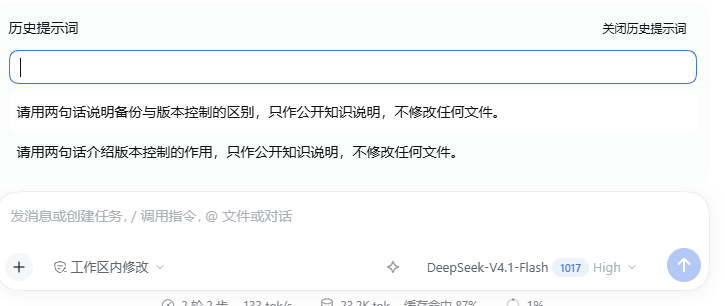 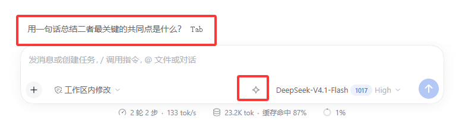 |
| **回退** | 气泡 / 时间线恢复 → 预览 → 撤销；会话统计行为可选捷径 |  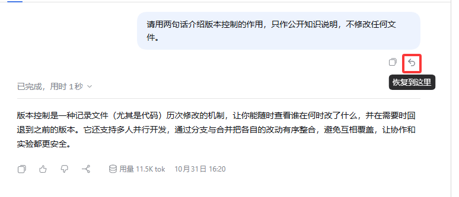 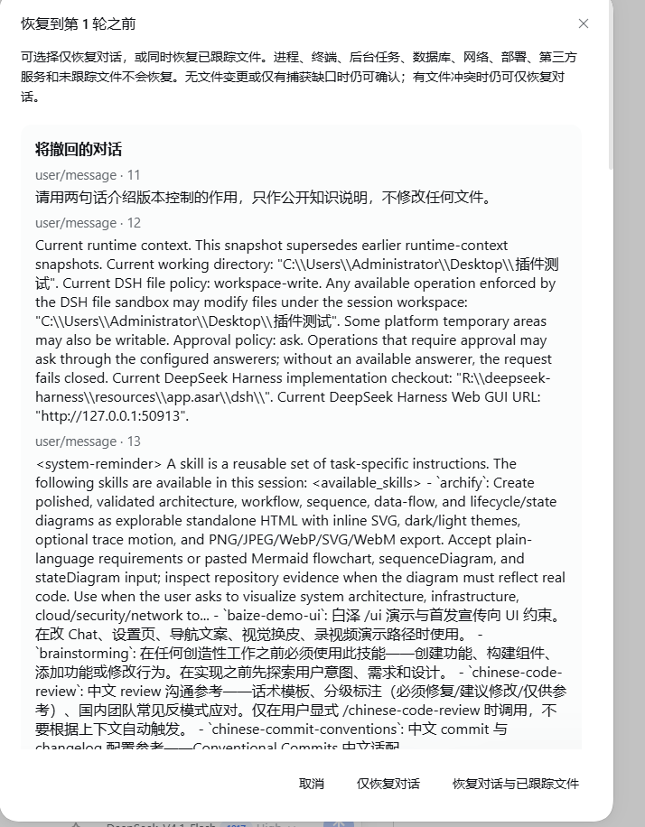 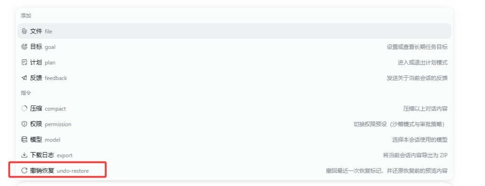 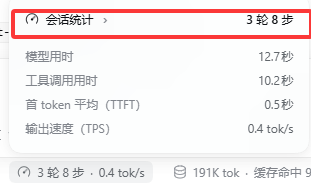 |
| **用量与成本** | Token 用量入口、模型账单、分账号余额 | 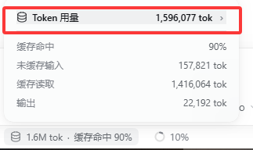 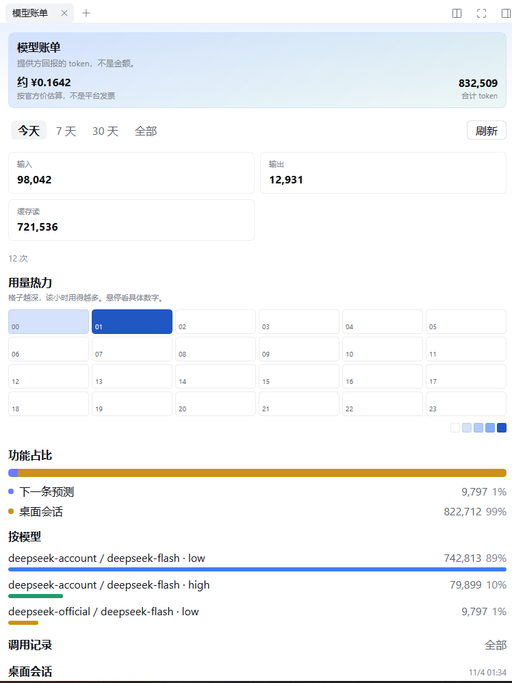 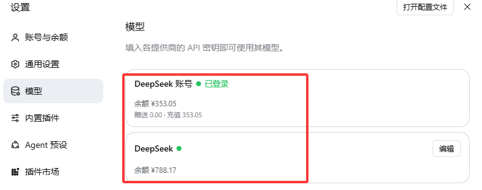 |
| **上下文** | 占用摘要与右侧栏明细 / 压缩 | 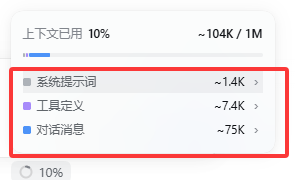 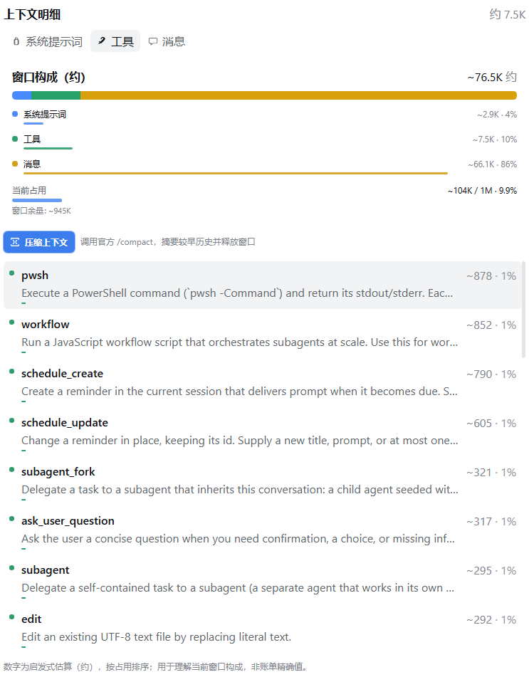 |
| **模型路由** | 模型列表 Auto；档位映射与可选分类器 | 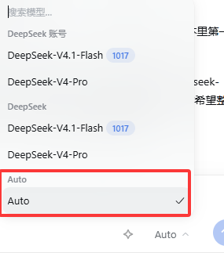 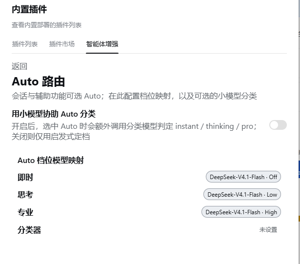 |
| **设置** | 智能体增强总开关与模型药丸 | 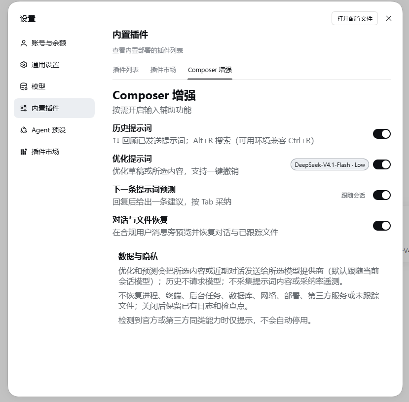 |

---

## 安装

安装 / 升级 / 卸载前，请退出所有 Desktop 窗口和托盘，确认旧主进程结束后再操作。  
本插件面向 **Desktop / `desktop` profile**（不要用 `web` 验收）。收录于 [awesome-dsh-plugin](https://github.com/awesome-dsh-plugin/awesome-dsh-plugin)，也可在第三方市场中搜索 `dsh-agent-enhancer` / **智能体增强**。

### 官方桌面端 · 应用内安装（推荐）

适用于 [DeepSeek Harness](https://github.com/deepseek-ai/deepseek-harness) **官方桌面端**（以及同样提供「设置 → 插件」的官方发行形态）：

1. 打开应用内 **设置 → 插件**（或侧边栏 **插件**）。
2. 在已安装 / 搜索框中查找 `dsh-agent-enhancer` 或 **智能体增强**，按提示安装。
3. 完全退出并重启 Desktop。

> 桌面端的 profile 由应用管理。不要用 `dsh plugin --profile web …` 往桌面端装插件——命令可能显示成功，但装进的是 `profiles/web`，桌面端看不到。

### dsh-market（可选）

需要独立的市场 UI / 一键升级时，可安装社区市场插件 [dsh-market](https://github.com/dsh-market/dsh-market)：

- **官方桌面端：** 在应用内 **设置 → 插件** 搜索 `dshmarket` 并安装（不要用 CLI 的 `web` profile）。
- **普通 `dsh web`：** `dsh plugin --profile web add dshmarket`，然后重启。

装好后打开 **插件市场** 标签，搜索并安装本插件。部分第三方桌面客户端会预装或推荐此市场。

### 命令行 · npm

本机已配置 `dsh` CLI、且要写入 **desktop** profile 时：

```sh
dsh plugin --profile desktop add dsh-agent-enhancer@0.3.2
```

也可不钉版本：`dsh plugin --profile desktop add dsh-agent-enhancer`。  
若曾安装旧包 `dsh-composer-enhancer`，请先卸载再装本包。  
启动后应能看到输入框右侧优化入口，以及设置中的 **智能体增强**。

### 本地目录（开发）

**不要**对本地仓库执行 `dsh plugin --profile desktop add <绝对路径>`：部分 Desktop / CLI 会把仓库里的 `package.json` 改写成 `@deepseek-ai/dsh-desktop-runtime` 依赖，破坏开发树。请手动 `link:`：

```powershell
corepack pnpm install --frozen-lockfile
corepack pnpm build

$Repo = (Resolve-Path .).Path -replace '\\','/'
$ProfileDir = if ($env:DSH_HOME) { Join-Path $env:DSH_HOME 'profiles\desktop' } else { Join-Path $env:USERPROFILE '.dsh\profiles\desktop' }
$ProfilePkg = Join-Path $ProfileDir 'package.json'
$json = Get-Content -LiteralPath $ProfilePkg -Raw | ConvertFrom-Json
if (-not $json.dependencies) { $json | Add-Member -NotePropertyName dependencies -NotePropertyValue ([pscustomobject]@{}) }
$json.dependencies | Add-Member -NotePropertyName 'dsh-agent-enhancer' -NotePropertyValue "link:$Repo" -Force
$bundles = @($json.dsh.profile.bundles)
if ($bundles -notcontains 'dsh-agent-enhancer') {
  $json.dsh.profile.bundles = @($bundles + 'dsh-agent-enhancer')
}
($json | ConvertTo-Json -Depth 20) | Set-Content -LiteralPath $ProfilePkg -Encoding utf8
dsh plugin --profile desktop install
```

然后完全退出并重启 Desktop。之后改代码只需再执行 `corepack pnpm build`（加载的是 `lib/`）。  
与宿主共享的 DSH 包请同时放在 `peerDependencies` 与 `devDependencies`，不要放进 `dependencies`。

---

## 隐私与共存

| 项目 | 说明 |
| --- | --- |
| 历史 | 不请求模型 |
| 优化 | 发送原稿或选区 + 最近一轮已完成对话 |
| 预测 | 发送最近一轮已完成对话 |
| Auto 分类器 | 仅开关打开时调用；失败回退本地启发式，不阻塞主请求 |
| 账单 / 上下文 | 本地汇总与启发式估算；余额查询使用 Desktop 已存凭据，插件不携带密钥 |
| 缓存 | 仅当前会话内存（账单落盘在本机 usage 目录） |
| 审计 | 本地 `plugin:agent-enhancer/request`（无遥测上传） |
| 共存 | 只提示，不自动关闭第三方 |

---

## 兼容

- **DSH：** `>=0.2.2-rc.1 <0.3.0-0`（Desktop `0.2.2-rc.1`+）

---

## 卸载

| 安装方式 | 做法 |
| --- | --- |
| 官方桌面端 / dsh-market | 在应用内 **插件** 页对本插件选择卸载或禁用；或 `dsh plugin --profile desktop remove dsh-agent-enhancer` |
| 命令行 npm | `dsh plugin --profile desktop remove dsh-agent-enhancer` |
| 本地 `link:` | **不要** `remove` / 在 profile 里 `pnpm remove`（可能删掉源仓库）。按下面做 |

1. 退出 Desktop（含托盘）  
2. 编辑 **profile** 的 `package.json`：从 `dependencies` 与 `dsh.profile.bundles` 去掉本插件  
3. 更新依赖并删除链接本身（不删链接目标）：

```powershell
$DshHome = if ($env:DSH_HOME) { $env:DSH_HOME } else { Join-Path $env:USERPROFILE '.dsh' }
$ProfileDir = Join-Path $DshHome 'profiles\desktop'
dsh plugin --profile desktop install
$PluginLink = Join-Path $ProfileDir 'node_modules\dsh-agent-enhancer'
$Item = Get-Item -LiteralPath $PluginLink -Force -ErrorAction SilentlyContinue
if ($Item -and $Item.LinkType -in @('SymbolicLink', 'Junction')) { $Item.Delete() }
```

---

## 开发

```powershell
corepack pnpm install --frozen-lockfile
corepack pnpm typecheck
corepack pnpm test
corepack pnpm build   # Desktop 加载 lib/
corepack pnpm check   # typecheck + test + build + 打包校验
```

| 路径 | 内容 |
| --- | --- |
| `src/host/` | 模型调用、RPC、检查点回滚、账单、Auto 路由、余额 |
| `src/client/` | 会话输入区、右侧栏账单 / 上下文、设置与模型页余额 |
| `tests/` | Vitest |
| `lib/` | 构建产物 |
| `docs/images/` | README 截图 |

---

## 许可

[MIT](./LICENSE)

更新日志见 [CHANGELOG.md](./CHANGELOG.md)。
