# DSH Agent Enhancer

[English](./README.en.md) | 简体中文

> 让 DeepSeek Harness Desktop **更好写、更好改、更好回退、更看得见用量与上下文**。  
> 能力嵌在官方会话与设置里，默认开启，可在 **设置 → 内置插件 → 智能体增强** 逐项关闭。

[](https://www.npmjs.com/package/dsh-agent-enhancer)
[](https://www.npmjs.com/package/dsh-agent-enhancer)
[](https://awesome-dsh-plugin.com)
[](./LICENSE)

---

## 功能

预览为 56×56 方图，点击打开原图。语言跟随 Desktop（`zh` / `en`）。

| 能力 | 用法 | 预览 |
| --- | --- | --- |
| **写提示** | `↑↓` / `Alt+R` 输入历史；右侧 **优化**（可撤销）；回复后 `Tab` 采纳建议下一条；预览 / 编辑器 / 终端划词 → **引用文本**（对话正文用官方划词引用） | <a href="https://github.com/rebornace/dsh-agent-enhancer/blob/main/docs/images/prompt-history.png">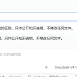</a> <a href="https://github.com/rebornace/dsh-agent-enhancer/blob/main/docs/images/optimize-and-predict.png">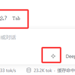</a> <a href="https://github.com/rebornace/dsh-agent-enhancer/blob/main/docs/images/select-to-quote.png">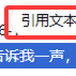</a> |
| **暂停后续** | 最新用户消息上 **暂停 / 继续**：先拦住下一轮模型调用，省后续 token；当前回复与已发出工具仍跑完。官方停止仍会硬中断 | <a href="https://github.com/rebornace/dsh-agent-enhancer/blob/main/docs/images/soft-pause-action.png">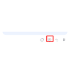</a> |
| **运行通知** | 结束 / 待批准 / 出错时提醒你；默认 **失焦时**（双屏或切到其他应用也提醒），可选仅后台 / 总是；失焦走系统通知，回焦可补提示 | |
| **检查点恢复** | 气泡或时间线 **恢复到这里**（可含已跟踪文本文件）→ 预览 → 确认；**+** / `/` **撤销恢复** | <a href="https://github.com/rebornace/dsh-agent-enhancer/blob/main/docs/images/checkpoint-timeline-entry.png">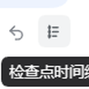</a> <a href="https://github.com/rebornace/dsh-agent-enhancer/blob/main/docs/images/rollback-entry.png">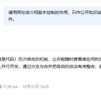</a> <a href="https://github.com/rebornace/dsh-agent-enhancer/blob/main/docs/images/rollback-preview.png">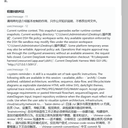</a> <a href="https://github.com/rebornace/dsh-agent-enhancer/blob/main/docs/images/undo-restore.png">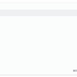</a> |
| **工作区** | 预览 **编辑**（Monaco）；指南胶囊 **附加目录**；左侧栏一级 **技能** / **连接器**（对齐官方插件页：列表 · 添加对话框 · 详情；技能 GitHub·Zip 可选 `~/.agents/skills` / `~/.dsh/skills` 或项目对应目录 → `/`；连接器 `mcp.json`）；会话 ⋯ **删除会话** | <a href="https://github.com/rebornace/dsh-agent-enhancer/blob/main/docs/images/skills-mcp-left-nav.png">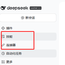</a> <a href="https://github.com/rebornace/dsh-agent-enhancer/blob/main/docs/images/file-edit-toolbar.png">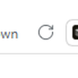</a> <a href="https://github.com/rebornace/dsh-agent-enhancer/blob/main/docs/images/extra-folders.png">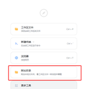</a> <a href="https://github.com/rebornace/dsh-agent-enhancer/blob/main/docs/images/session-delete.png">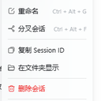</a> |
| **Token 用量** | 输入区入口 → 用量汇总；**设置 → 模型** 查看账号余额 | <a href="https://github.com/rebornace/dsh-agent-enhancer/blob/main/docs/images/token-usage-meter.png">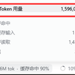</a> <a href="https://github.com/rebornace/dsh-agent-enhancer/blob/main/docs/images/model-bill.png">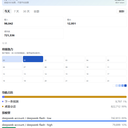</a> <a href="https://github.com/rebornace/dsh-agent-enhancer/blob/main/docs/images/provider-balance.png">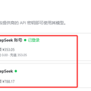</a> |
| **上下文占用** | 占用环 → 右侧明细；可一键压缩上下文 | <a href="https://github.com/rebornace/dsh-agent-enhancer/blob/main/docs/images/context-meter.png">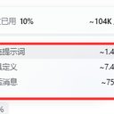</a> <a href="https://github.com/rebornace/dsh-agent-enhancer/blob/main/docs/images/context-details.png">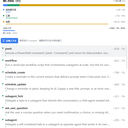</a> |
| **路由** | 模型列表选 **Auto**；设置映射 Instant / Thinking / Pro | <a href="https://github.com/rebornace/dsh-agent-enhancer/blob/main/docs/images/auto-model-picker.png">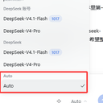</a> <a href="https://github.com/rebornace/dsh-agent-enhancer/blob/main/docs/images/auto-routing-settings.png">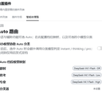</a> |
| **网页聊天** | 设置打开（**默认开**）→ 左栏打开官方网页版聊天；「转到工作区」= **导入当前对话**（`history_messages` + Bearer）或 **导入分享链接**（任意账号公开分享）→ 预览（仅 Q&A）→ 新建工作会话；接口带思考 / 联网片段时写入保真。**全量** `deepseek_data-*.zip` 请用官方实验插件「DeepSeek 会话导入」。不把网页额度接到本地 API | <a href="https://github.com/rebornace/dsh-agent-enhancer/blob/main/docs/images/web-chat-left-nav.png">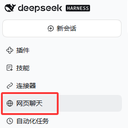</a> <a href="https://github.com/rebornace/dsh-agent-enhancer/blob/main/docs/images/web-chat-to-workspace.png">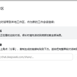</a> |
| **浏览器控制** | 设置打开（默认关）→ 选专用浏览器：**Mac** 自动 / Chrome / Safari；**Windows** 自动 / Chrome / Edge。对话或 Alt+点击可**自动启动**独立窗口；设置或侧栏切换立即生效；侧栏可切换多标签，并可把某标签设为**只读**（只看不改）；变更默认需批准（权限选「完全权限」，或流程开了「允许无人值守」，才不再逐次询问）；登录墙点「我已完成」；可选**调试与页面模拟**（网络 / 控制台 / 深色模式与视口）；**演示录制**可让你演示一遍流程（跨标签也能录），步骤可复制、发回输入框、让智能体当场重放，或**保存为流程**下次一键再跑（智能体也能按名字直接跑；参数用页面上的名字，日期可以直接说「上周」；网站改版后控件变了，它会补完并问你要不要记住；流程可设为**无人值守**（定时任务里同一站点、限时、限次数，额度可在设置里改，默认 20 分钟 / 30 次），每次运行的结果会记在流程上）；闲置标签可按 10 / 30 / 60 分钟自动关闭，或选择不自动关闭。不同于官方侧栏网页浏览 | <a href="https://github.com/rebornace/dsh-agent-enhancer/blob/main/docs/images/browser-agent-guide.png">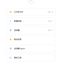</a> <a href="https://github.com/rebornace/dsh-agent-enhancer/blob/main/docs/images/browser-agent-flows.png">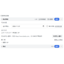</a> <a href="https://github.com/rebornace/dsh-agent-enhancer/blob/main/docs/images/browser-agent-settings.png">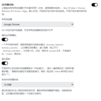</a> |
| **远程控制** | 设置 **远程连接** 页（默认开，未绑定不工作）→ **微信**扫码登录、填 **Telegram Bot Token**，或填**飞书自建应用**的 App ID / App Secret 连接（飞书推荐用「创建飞书智能体应用」模板）→ 生成 **6 位绑定码**，在对应聊天里发给机器人 → 之后可发「任务」「切 2」「批准 a3f9」「拒绝」「详情」「暂停」「继续」「回答 …」或直接追加指令；`切 N` / `详情` 直接给出该任务的卡片和回答，按钮只针对它，回列表发「任务」。只操作**已有会话**，不新开会话；**每个完成回合都会把模型最终回答推回**；审批 / 提问 / 失败也会主动推送；待办不跨宿主重启。**注意：** 微信 iLink 的主动推送依赖最近一条入站消息生成的上下文；长时间没和机器人说话时，微信会在推送时返回 `ret=-2`，给机器人发一条消息即可恢复；Telegram 在当前网络下可能无法连通。需要稳定的主动审批建议用**飞书**。微信语音直接用转写，Telegram / 飞书只收文字；图片和文件请回电脑查看 | <a href="https://github.com/rebornace/dsh-agent-enhancer/blob/main/docs/images/remote-control-feature.png">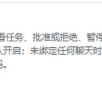</a> <a href="https://github.com/rebornace/dsh-agent-enhancer/blob/main/docs/images/remote-feishu.png">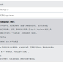</a> |
| **设置** | **功能** 十六开关（简单项直出，浏览器高级项折叠）· **远程连接** 微信 / Telegram / 飞书 · **模型与路由** 辅助模型 / Auto · **关于** 说明 | <a href="https://github.com/rebornace/dsh-agent-enhancer/blob/main/docs/images/settings.png">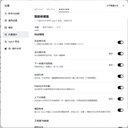</a> |

**边界（精简）：** 划词引用不调模型；对话正文交给官方引用，本插件覆盖预览 / 编辑器 / 终端；流式回复与 HTML/PDF/Excel 预览暂不可划词。检查点恢复仅覆盖对话与已跟踪文本文件，不恢复进程 / 终端 / 未跟踪 / 二进制。附加目录不扩大智能体可访问范围。技能与连接器在左侧栏（「插件」下方）；技能可从 GitHub / Zip 安装到 `.agents/skills` 或 `.dsh/skills`，用 `/` 调用；连接器用 `mcp.json` 管理。删除会话不可恢复。上下文占用为估算；用量「约 ¥」非发票。暂停后续只拦住**之后**尚未发生的模型调用。运行通知走系统通知中心，失败则回焦后补提示。网页聊天内嵌 `chat.deepseek.com`（首次需网页登录）；转到工作区为「导入当前对话 / 导入分享链接」（预览仅 Q&A；接口有思考片段才写入）；全量 ZIP 请用官方「DeepSeek 会话导入」；不把网页额度接到本地 API。浏览器控制使用平台专用窗口（Mac：Safari/WebKit 或 Chrome；Windows：Chrome 或 Edge；独立配置可保留登录）；Mac 上 Safari 选项驱动的是 Playwright WebKit（Safari 引擎），**不是**日常 Safari.app 本体；对话或 Alt+点击可自动启动；变更默认需批准（完全权限 / 允许无人值守除外）；不自动绕过登录墙；关闭开关即卸工具并关掉专用浏览器。只读标签只拦点击 / 输入 / 同标签导航 / 流程重放，读工具与滚轮不受限；调试工具只记 URL、状态、耗时与 console 文本，**不读请求头、Cookie、响应体**，URL 中的疑似密钥会被掩码；闲置标签按所选时长（10 / 30 / 60 分钟，或不自动关闭）关闭，会话绑定 / 当前 / 最后一个不关。

功能页开关：`history` · `optimize` · `predict` · `quote` · `rollback` · `softPause` · `runAlerts` · `contextInspect` · `usage` · `sessionDelete` · `fileEdit` · `instructionsSkills` · `mcpConnectors` · `webChatBridge`（均默认开；附加目录随 `fileEdit`；网页聊天：导入当前对话 / 导入分享链接，可新建工作区）· `browserAgent`（**默认关**；Mac：`auto`/`chrome`/`safari`；Windows：`auto`/`chrome`/`edge`；变更批准仅弹框）· `remoteControl`（**默认开**，未绑定不工作；微信扫码 / Telegram Bot Token；一次性绑定码；只控制已有会话）。

---

## 安装

面向 **Desktop / `desktop` profile**（不要用 `web` 验收）。装前请退出 Desktop（含托盘）。

| 方式 | 步骤 |
| --- | --- |
| **应用内（推荐）** | **设置 → 插件** 搜索 `dsh-agent-enhancer` / **智能体增强** → 安装 → 重启 |
| **CLI** | `dsh plugin --profile desktop add dsh-agent-enhancer@0.4.1` |
| **开发** | `corepack pnpm install --frozen-lockfile` → `corepack pnpm desktop:link` → 重启；切回线上：`corepack pnpm desktop:npm` |

可选市场：[dsh-market](https://github.com/dsh-market/dsh-market)（应用内搜 `dshmarket`，勿用 `web` profile）。曾装 `dsh-composer-enhancer` 请先卸再装本包。

> 不要 `dsh plugin --profile web …` 往桌面端装；不要对仓库路径 `add` / `link:` / `file:`（Windows Junction 会暴露仓库 `node_modules`，插件会一直关闭）。本地开发用 `desktop:link`（pack 快照，改代码需再 link）。

**卸载：** 应用内卸载，或 `dsh plugin --profile desktop remove dsh-agent-enhancer`。开发安装勿直接 `remove`（可能删源仓库）——先改 profile `package.json` 去掉依赖，再删 `node_modules` 里的链接本身。

**兼容：** DSH `>=0.2.2-rc.2 <0.3.0-0`。

---

## 隐私

- 历史 / 划词引用：不请求模型。优化 / 预测：仅发送必要草稿或最近一轮对话。
- 账单与上下文本地汇总；余额用 Desktop 已存凭据，插件不携带密钥。无遥测上传。
- 与第三方重叠能力只提示，不自动关闭。

---

## 开发

```powershell
corepack pnpm install --frozen-lockfile
corepack pnpm check   # typecheck + test + build + 打包校验
```

**Mac 本地联调 Desktop：**

```bash
# 可选：Safari/WebKit 引擎（Auto 优先 / 锁定 Safari 时需要）
npx playwright install webkit

# 退出 Desktop（含托盘）后 link 本地包
./scripts/mac-desktop-link.sh
# 等价：corepack pnpm desktop:link → 重启 DeepSeek Harness
```

Mac 上若 PATH 没有 `dsh`，可用 App 内 CLI：  
`/Applications/DeepSeek Harness.app/Contents/Resources/runtime/cli/bin/dsh`

`src/host/` 服务端 · `src/client/` UI · `tests/` · `lib/` 构建产物 · `docs/images/` 截图（`thumbs/` 由 `scripts/make-readme-thumbs.py` 生成）。

插件版本更新请用官方 Desktop 插件更新；本插件不再提供「关于」页自检更新。

**边界：** 浏览器 Agent 使用独立专用窗口，不附着你的日常浏览器；真实登录态、文件上传这类扩展按实际使用评估，不在 README 里排期。微信远程只控制已有会话，不新开会话；绑定码一次性、10 分钟；待办审批不跨宿主重启；bot token 存在宿主凭据服务，不落明文文件；关闭开关即停止轮询并卸下审批拦截。优先级与不变量见 [AGENTS.md](./AGENTS.md)。

---

## 许可

[MIT](./LICENSE) · [CHANGELOG](./CHANGELOG.md) · [迭代优先级](./AGENTS.md)
